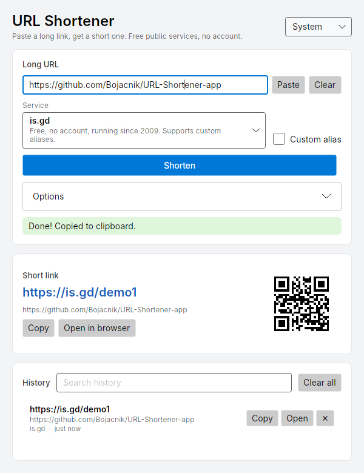

# URL Shortener

A small cross-platform desktop app for shortening links, built with [Avalonia UI](https://avaloniaui.net/) and .NET 10. Runs on Linux, Windows and macOS.



## Features

- **Four free public services, no account or API key:** [is.gd](https://is.gd) (default), [TinyURL](https://tinyurl.com), [da.gd](https://da.gd) and [v.gd](https://v.gd).
- **Automatic fallback:** if the chosen service is down or rate-limiting, the next one is tried. Input errors such as an invalid URL or a taken alias don't trigger a fallback.
- **Custom aliases** (`is.gd/my_link`), checked against each service's rules before sending.
- **Input validation as you type.** `example.com` works without `https://`. Local and private-network addresses are rejected.
- **Copy to clipboard** automatically or with a button (`Ctrl+Shift+C`), and **open in browser**.
- **QR code** for every short link.
- **Searchable history** of your last 200 links.
- **Light, dark or system theme.** Settings are remembered.

History and settings are stored as JSON in your user config folder (`~/.config/UrlShortener` on Linux, `%APPDATA%\UrlShortener` on Windows).

## Run

Requires the [.NET 10 SDK](https://dotnet.microsoft.com/download).

```bash
dotnet run --project src/UrlShortener.App
```

Build a self-contained single file (swap in `win-x64` or `osx-arm64` for other platforms):

```bash
dotnet publish src/UrlShortener.App -c Release -r linux-x64 --self-contained -p:PublishSingleFile=true -o publish
./publish/UrlShortener
```

## Test

```bash
dotnet test
```

The tests cover the providers (with a fake HTTP handler, no network), fallback logic, validation, storage and the view model. A headless Avalonia test drives the real window: it types a URL, presses Enter and checks the result. Set `SCREENSHOT_DIR` to save rendered frames.

## Project layout

| Project | What's in it |
| --- | --- |
| `src/UrlShortener.Core` | Provider abstraction and implementations, `ShortenerService` (fallback), URL validation, JSON storage. No UI dependencies. |
| `src/UrlShortener.App` | Avalonia app: MVVM with CommunityToolkit.Mvvm, Fluent theme, compiled bindings. |
| `tests/UrlShortener.Tests` | xUnit v3 + Avalonia.Headless tests. |

### Adding a service

Subclass `ShortenerProviderBase`. Implement `BuildRequestUri` and `ParseResponse`, set the alias rules, then register the class in `ShortenerService.CreateDefault`.

## History

Version 1 was a WinForms app for .NET Framework 4.8 that used the CleanURI API. CleanURI has since shut down.
