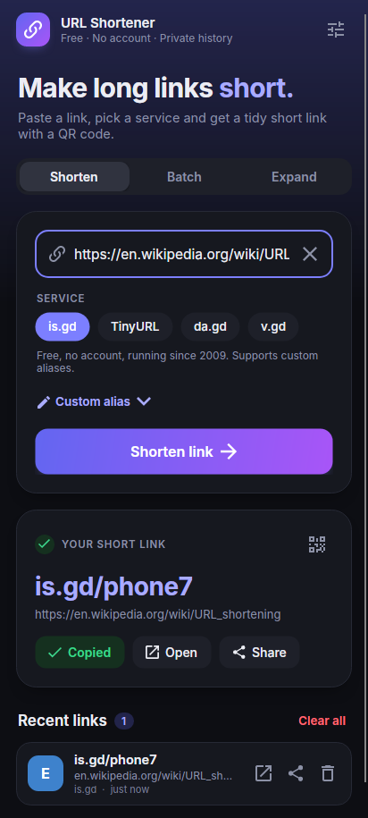
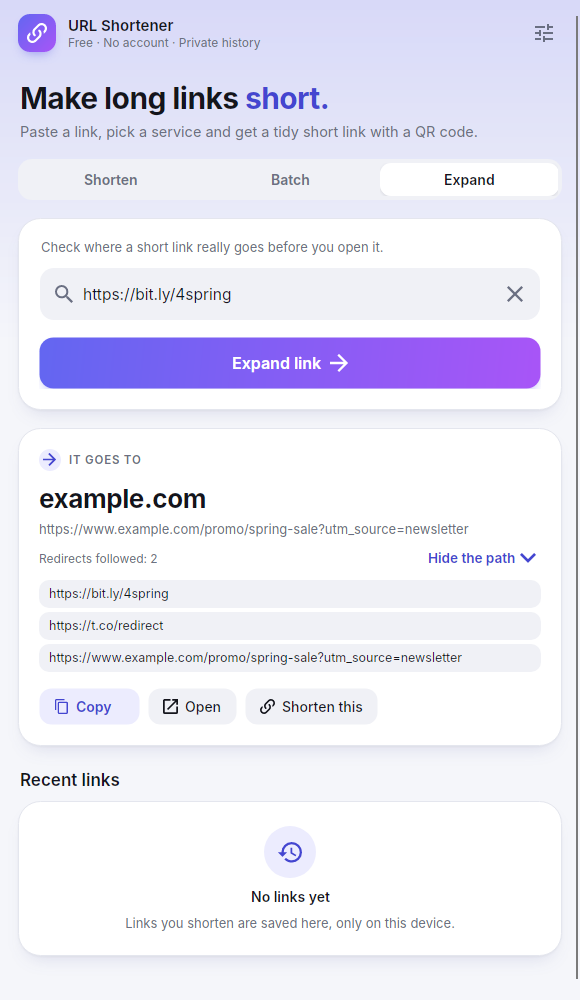
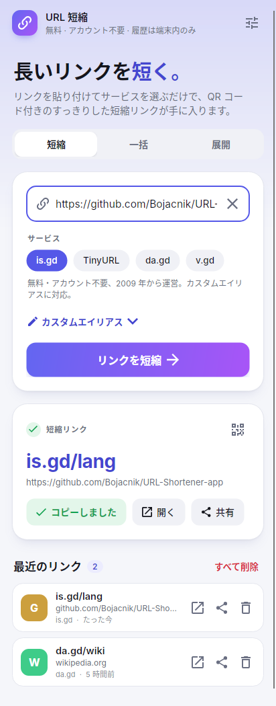

# URL Shortener

[](https://github.com/Bojacnik/URL-Shortener-app/actions/workflows/ci.yml)
[](LICENSE)

A link shortener for **Windows, Linux, macOS and Android**, built with [Avalonia UI](https://avaloniaui.net/) and .NET 10. The same UI runs on all of them.

<p>
  
  
</p>
<p>
  
  
</p>

## Features

- **Shorten:** four free public services with no account or API key: [is.gd](https://is.gd) (the default), [TinyURL](https://tinyurl.com), [da.gd](https://da.gd) and [v.gd](https://v.gd). If the chosen service is down, the next one is tried automatically. Supports custom aliases (`is.gd/my_link`).
- **Batch:** paste up to 50 links, one per line, and shorten them all. Copy the results as a list, or as a two-column table that pastes straight into Excel, LibreOffice or Google Sheets.
- **Expand:** paste a short link to see where it really goes before you open it. Redirects are followed without loading any page, the whole path is shown, and following stops before any local or private network address.
- **18 languages:** English, Español, Čeština, Deutsch, Français, Italiano, Português (Brasil), Polski, Nederlands, Русский, Українська, Türkçe, Bahasa Indonesia, العربية (right-to-left), हिन्दी, 简体中文, 日本語 and 한국어. The app follows your system language by default; change it in Settings.
- **One-tap actions:** Copy (automatic by default; `Ctrl+Shift+C` on desktop), Open, Share (Android), and a QR code.
- **Searchable recent links:** history is stored only on this device.
- **Light, dark or system theme**, with small animations throughout.
- **Android Share menu:** in Chrome, YouTube or any other app, choose *Share → URL Shortener*. Long links are shortened right away; short links are expanded.
- **Desktop shortcut:** `UrlShortener --quick` shortens whatever link is on the clipboard in a small pop-up, copies the result and closes. Give it a keyboard shortcut in your system settings (KDE: *System Settings → Shortcuts → Add Command*; GNOME: *Settings → Keyboard → Custom Shortcuts*; Windows: a shortcut file with a *Shortcut key*). It works on Wayland too.
- **Command line:** `UrlShortener shorten <url> [--service is.gd|tinyurl|da.gd|v.gd] [--alias name]` prints the short link, for scripts and terminals on Linux and macOS.

History and settings are saved as JSON in the per-user app data folder (`~/.config/UrlShortener` on Linux, `%APPDATA%\UrlShortener` on Windows, and app-private storage on Android).

## Download

Get the latest version from the [**Releases**](https://github.com/Bojacnik/URL-Shortener-app/releases) page:

| Platform | File |
| --- | --- |
| Windows | `UrlShortener-vX.Y.Z-win-x64.zip` (contains `UrlShortener.exe`) |
| Linux | `UrlShortener-vX.Y.Z-linux-x64.tar.gz` (a single executable) |
| macOS (Apple Silicon) | `UrlShortener-vX.Y.Z-osx-arm64.tar.gz` |
| Android 6.0+ | `UrlShortener-vX.Y.Z-android.apk` (for 64-bit ARM and x86 devices; allow "install unknown apps" to sideload) |

Every push also builds these, available as artifacts under **Actions**.

### Verify a download

Each release includes a `SHA256SUMS` file and a signed [build attestation](https://docs.github.com/en/actions/security-guides/using-artifact-attestations-to-establish-provenance-for-builds). Together they prove the file is intact and was built by this repository's release workflow, not uploaded by someone else.

```bash
# The file wasn't corrupted or swapped:
sha256sum -c SHA256SUMS --ignore-missing

# The file was built by GitHub Actions from this repo (needs the GitHub CLI):
gh attestation verify UrlShortener-v2.1.0-linux-x64.tar.gz -R Bojacnik/URL-Shortener-app
```

On Windows, use `Get-FileHash <file>` in PowerShell and compare the result with `SHA256SUMS`.

### First start on Windows and macOS

The desktop builds aren't code-signed yet, so the first time you start them:
- **Windows:** SmartScreen shows "Windows protected your PC". Click **More info → Run anyway**.
- **macOS:** open the app, then go to **System Settings → Privacy & Security** and click **Open Anyway**.
- **Linux:** run `chmod +x UrlShortener` if needed, then `./UrlShortener`.

## Build it yourself

Requires the [.NET 10 SDK](https://dotnet.microsoft.com/download).

```bash
# Desktop: run
dotnet run --project src/UrlShortener.Desktop

# Desktop: single-file build (swap linux-x64 for win-x64 or osx-arm64)
dotnet publish src/UrlShortener.Desktop -c Release -r linux-x64 --self-contained -p:PublishSingleFile=true -o publish

# Android: needs the workload, a JDK (17+) and the Android SDK
dotnet workload install android
dotnet publish src/UrlShortener.Android -c Release -p:AndroidSdkDirectory=$ANDROID_HOME -o publish
adb install publish/com.bojacnik.urlshortener-Signed.apk
```

The Android build is signed with the debug key, which is fine for sideloading. Publishing to Google Play needs your own keystore (`AndroidSigningKeyStore` and related properties).

## Test

```bash
dotnet test tests/UrlShortener.Tests
```

There are 151 tests:
- **Providers:** run against a fake HTTP handler, so no network is needed.
- **Logic and storage:** fallback, validation, storage, and the view models (batch, expand, quick mode).
- **Translations:** every language must have every string, with the same `{0}` placeholders as English.
- **Headless UI tests:** they drive the real views (type a URL, press Enter, check the result) and render desktop and phone-sized screenshots, including Arabic (right-to-left), Japanese and Hindi. Set `SCREENSHOT_DIR` to keep the screenshots.

## Project layout

| Project | What's in it |
| --- | --- |
| `src/UrlShortener.Core` | Providers, `ShortenerService` (fallback), URL validation, JSON storage. No UI. |
| `src/UrlShortener.UI` | Shared Avalonia UI: `MainView`, view models, styles, icons, animations. |
| `src/UrlShortener.Desktop` | Desktop app (Windows, Linux, macOS). |
| `src/UrlShortener.Android` | Android app: activity, Share intent, icons, splash screen. |
| `tests/UrlShortener.Tests` | xUnit v3 + Avalonia.Headless. |

Repo-wide files:
- `Directory.Packages.props`: one version per NuGet package.
- `Directory.Build.props`: settings shared by all projects (language, version, metadata; warnings become errors in CI).
- `global.json`: pins the .NET 10 SDK.
- `.editorconfig`: code style, which CI checks with `dotnet format`.
- `.gitattributes`: line endings.
- `.github/dependabot.yml`: weekly dependency updates.

### Adding or improving a translation

The strings live in `src/UrlShortener.UI/i18n/<language>.json`, and English (`en.json`) is the reference. To add a language, copy `en.json`, translate the values, and add the language to `Loc.Languages` in `src/UrlShortener.UI/Localization/Loc.cs`. The tests check that nothing is missing. The translations were written with AI assistance, so corrections from native speakers are very welcome.

### Adding a service

Subclass `ShortenerProviderBase`. Implement `BuildRequestUri` and `ParseResponse`, set the alias rules, then register the class in `ShortenerService.CreateDefault`.

## Releasing

1. Move the `[Unreleased]` notes in [CHANGELOG.md](CHANGELOG.md) under a new version heading.
2. Tag and push: `git tag v2.2.0 && git push origin v2.2.0`.

The [release workflow](.github/workflows/release.yml) tests the code, builds every platform with the version from the tag, and publishes a GitHub Release. The release notes are taken from the changelog.

## History

See [CHANGELOG.md](CHANGELOG.md). Version 1 was a WinForms app for .NET Framework 4.8 that used the CleanURI API, which has since shut down.

## License

[MIT](LICENSE) © 2025-2026 Bojacnik
