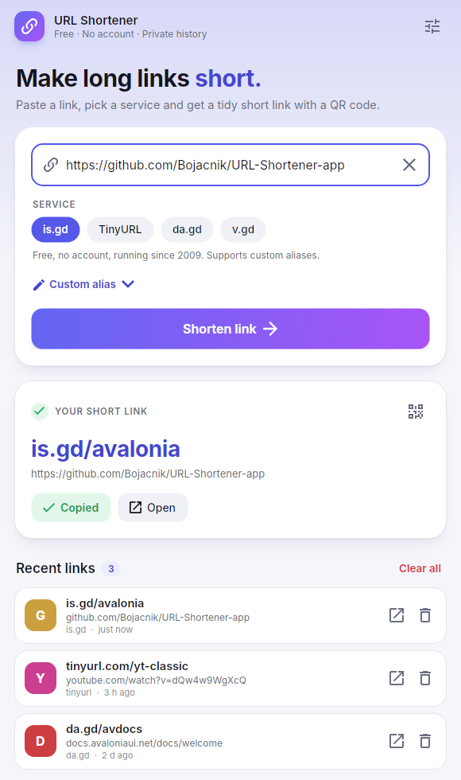

# URL Shortener

A link shortener for **Windows, Linux, macOS and Android**, built with [Avalonia UI](https://avaloniaui.net/) and .NET 10. The same UI runs on all of them.

<p>
  
  
</p>

## Features

- **Four free public services, with no account or API key:** [is.gd](https://is.gd) (the default), [TinyURL](https://tinyurl.com), [da.gd](https://da.gd) and [v.gd](https://v.gd).
- **Automatic fallback:** if the chosen service is down or rate-limiting, the next one is tried. Your own mistakes, such as an invalid URL or an alias that's taken, don't trigger a fallback.
- **Custom aliases** (`is.gd/my_link`), checked against each service's rules as you type.
- **Live validation:** `example.com` works without `https://`. Local and private-network addresses are rejected.
- **One-tap actions:** Copy (automatic by default; `Ctrl+Shift+C` on desktop), Open, Share (Android), and a QR code.
- **Searchable recent links:** tap a row to copy the link again. History is stored only on this device.
- **Light, dark or system theme**, with small animations: cards fade in, the Copy button confirms "Copied", and a toast appears for actions.
- **Android Share menu:** in Chrome, YouTube or any other app, choose *Share → URL Shortener* and the link is shortened right away.

History and settings are saved as JSON in the per-user app data folder (`~/.config/UrlShortener` on Linux, `%APPDATA%\UrlShortener` on Windows, and app-private storage on Android).

## Download

Every push builds the apps in GitHub Actions. Open the latest run under **Actions** and download:

| Platform | Artifact |
| --- | --- |
| Linux | `UrlShortener-linux-x64` (single executable) |
| Windows | `UrlShortener-win-x64` (`UrlShortener.exe`) |
| macOS (Apple Silicon) | `UrlShortener-osx-arm64` |
| Android 6.0+ | `UrlShortener-android` (`.apk` for 64-bit ARM and x86 devices; allow "install unknown apps" to sideload) |

## Build it yourself

Requires the [.NET 10 SDK](https://dotnet.microsoft.com/download).

```bash
# Desktop: run
dotnet run --project src/UrlShortener.Desktop

# Desktop: single-file build (swap linux-x64 for win-x64 or osx-arm64)
dotnet publish src/UrlShortener.Desktop -c Release -r linux-x64 --self-contained -p:PublishSingleFile=true -o publish

# Android: needs the workload, a JDK (17+) and the Android SDK
dotnet workload install android
dotnet publish src/UrlShortener.Android -c Release -p:AndroidSdkDirectory=$ANDROID_HOME -o publish
adb install publish/com.bojacnik.urlshortener-Signed.apk
```

The Android build is signed with the debug key, which is fine for sideloading. Publishing to Google Play needs your own keystore (`AndroidSigningKeyStore` and related properties).

## Test

```bash
dotnet test tests/UrlShortener.Tests
```

There are 70 tests:
- **Providers:** run against a fake HTTP handler, so no network is needed.
- **Logic and storage:** fallback, validation, storage, and the view model.
- **Headless UI tests:** they drive the real views (type a URL, press Enter, check the result) and render desktop and phone-sized screenshots. Set `SCREENSHOT_DIR` to keep the screenshots.

## Project layout

| Project | What's in it |
| --- | --- |
| `src/UrlShortener.Core` | Providers, `ShortenerService` (fallback), URL validation, JSON storage. No UI. |
| `src/UrlShortener.UI` | Shared Avalonia UI: `MainView`, view models, styles, icons, animations. |
| `src/UrlShortener.Desktop` | Desktop app (Windows, Linux, macOS). |
| `src/UrlShortener.Android` | Android app: activity, Share intent, icons, splash screen. |
| `tests/UrlShortener.Tests` | xUnit v3 + Avalonia.Headless. |

Package versions are managed centrally in `Directory.Packages.props`.

### Adding a service

Subclass `ShortenerProviderBase`. Implement `BuildRequestUri` and `ParseResponse`, set the alias rules, then register the class in `ShortenerService.CreateDefault`.

## History

Version 1 was a WinForms app for .NET Framework 4.8 that used the CleanURI API, which has since shut down.
